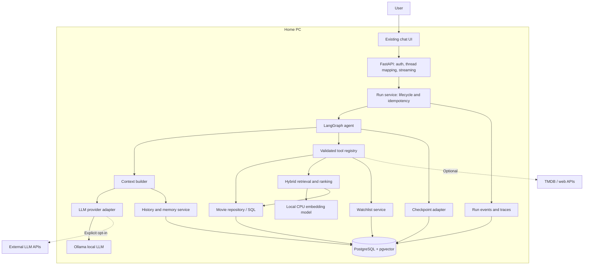
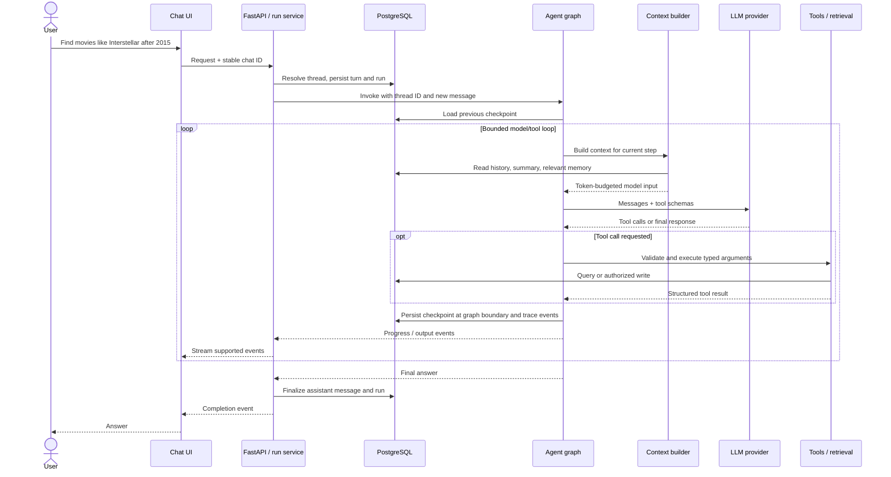
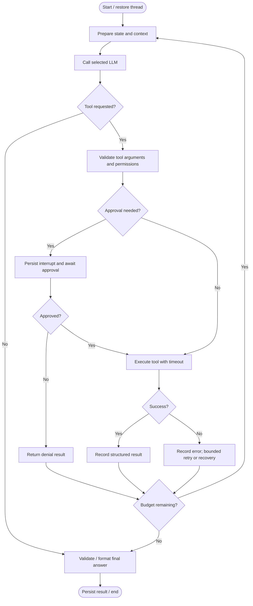
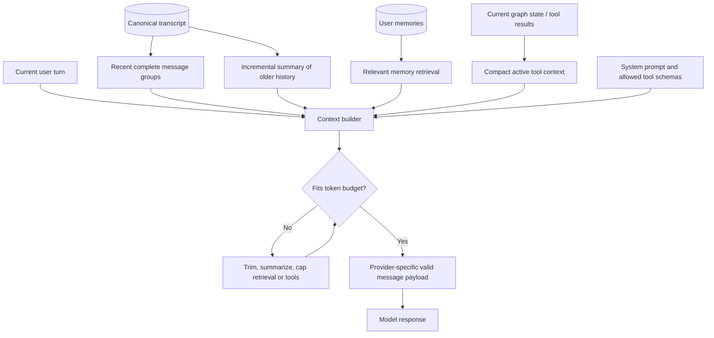
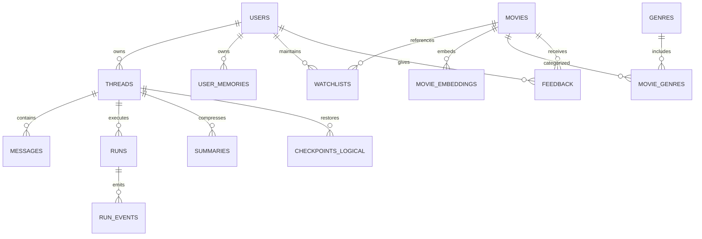
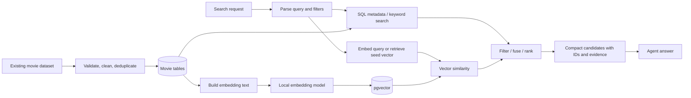
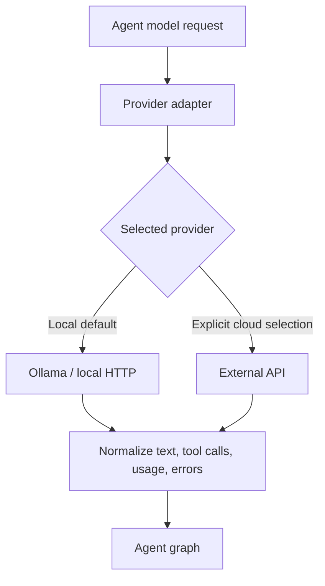
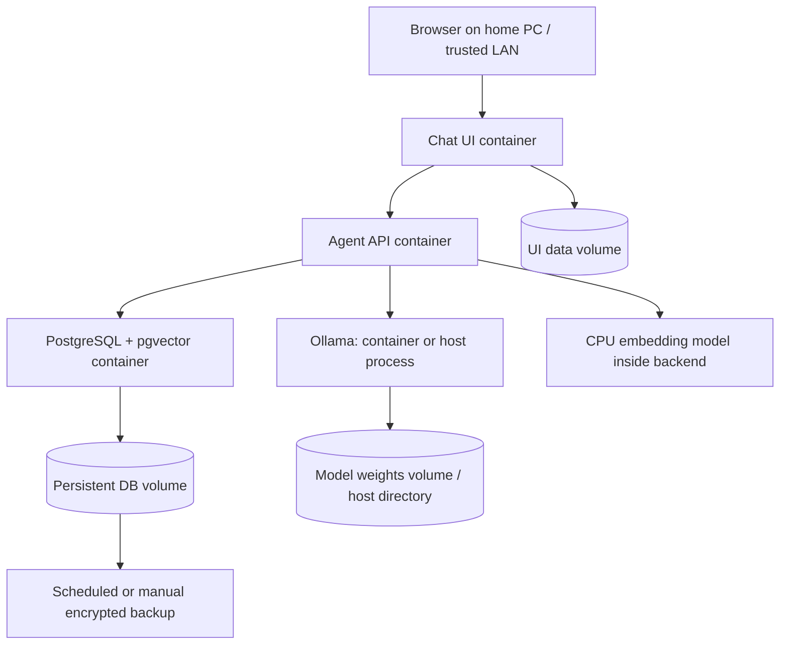
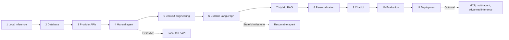

# CineAgent — Local-first AI Agent Architecture & Learning Roadmap

> Architecture proposal • Version 1.0 • 16 November 2026

## 1. Project goals and constraints

Build a movie assistant that answers factual questions, searches by meaning, finds similar movies, compares candidates, remembers conversations, and manages watchlists. The movie domain is the first implementation of a reusable stateful agent platform.

The primary learning goals are **durable agent execution** (saving and resuming the flow) and **context engineering** (deciding what the model sees on each request). Secondary goals are local inference, tool calling, retrieval, evaluation and deployment.

Constraints:
- Run on one consumer PC, including the database and embedding model.
- Local LLM by default, optional external LLM APIs through a provider abstraction. No silent cloud fallback.
- Reuse an existing chat UI; avoid custom frontend unless the integration cannot meet requirements.
- Use a modular monolith and Docker Compose, not microservices or Kubernetes.
- Start with one user and limited concurrency; add authentication before sharing the service.
- Hardware and existing dataset schema are not yet known. Model sizes, context length and resource limits are provisional.

## 2. Technology decisions

| Component | Initial choice | Why / alternatives |
|---|---|---|
| Runtime | Python 3.12, uv | Typed async application; reproducible dependencies |
| API | FastAPI, Pydantic | Validation, streaming, explicit contracts |
| Agent | Manual loop, then LangGraph | Learn mechanics before framework; persistent state and interrupts |
| LLM serving | Ollama | Simple local inference; experiment with llama.cpp or vLLM later |
| Provider interface | Own small adapter, then optional LiteLLM library | Keep local and external providers interchangeable; avoid a separate proxy initially |
| Embeddings | Sentence Transformers on CPU, e.g. BGE-small or MiniLM | Avoid GPU contention; Ollama embeddings optional |
| Database | PostgreSQL + pgvector | Movies, vectors, history, checkpoints in one instance |
| Data access | SQLAlchemy + Alembic | Repositories, transactions, migrations |
| Checkpoints | LangGraph PostgresSaver / AsyncPostgresSaver | Durable graph state; framework-managed schema |
| Chat UI | Open WebUI or LibreChat | Reuse UI; verify stable thread ID and streaming integration |
| Debug UI | Chainlit (optional alternative) | Easier custom agent controls / execution steps without a full frontend |
| Observability | Structured logs + local event store; OpenTelemetry later | Inspect flow without heavy infrastructure |
| Evaluation | Pytest + custom evaluation scripts; Ragas optional | Deterministic and model-based quality checks |
| Deployment | Docker Compose + persistent volumes | One machine; reproducible deployment |
| CI | GitHub Actions | Automated tests and linting |

Open WebUI is source-available with branding conditions in recent releases; if OSI-approved licensing is a strict requirement, evaluate LibreChat or Chainlit and verify the chosen release license. Exact version compatibility should be checked and pinned during implementation.

## 3. Whole application architecture



**Responsibility boundaries:** UI renders chat; API authenticates and maps sessions; run service owns lifecycle; agent chooses tools; context builder constructs the model input; tools execute validated business operations; repositories access data. The LLM never directly connects to PostgreSQL. Local-only mode disables all external provider and tool calls.

## 4. End-to-end request flow



A turn is one user request; a run is one execution attempt or continuation; a thread is the ongoing conversation. Keep separate identifiers for all three. Checkpoints happen at framework-defined graph boundaries, not necessarily after every streaming token or line of code.

## 5. Agent graph



Start with a manual loop that submits messages, reads tool calls, validates JSON arguments, executes functions and sends tool results back. Then implement the same behavior in LangGraph with explicit state and conditional edges. Bound iterations, wall-clock time, retries, tool result size and output tokens. If limits are reached, return a transparent partial result rather than inventing an answer.

## 6. Durable execution — priority learning module

### 6.1 What to persist

| Record | Purpose |
|---|---|
| Transcript | Canonical user-visible messages |
| Graph state | Current structured working state, including active message/tool context |
| Checkpoints | Framework snapshots for restart, resume, inspection and branching |
| Run events | Observable model calls, tool calls, errors, durations and status changes |
| Long-term memory | Deliberately selected preferences/facts across threads |
| Application data | Movies, watchlists and ratings; independent of agent state |

Do not store or attempt to recover hidden model reasoning. Persist observable messages, structured decisions, tool requests/results and provider metadata as needed. A model call interrupted mid-generation is normally retried, not resumed at the exact token.

### 6.2 State design

Suggested state fields: `messages` (bounded working history with stable IDs and a message reducer), `user_id`, `thread_id`, `turn_id`, `run_id`, `model_id`, `candidate_movie_ids`, `pending_action`, `step_count`, `error`, and `context_policy_version`. Keep large tool payloads outside checkpoints where practical and persist references to them. Do not place secrets, database connections or model clients in serialized state.

### 6.3 Crash recovery and idempotency

```mermaid
sequenceDiagram
    participant R as Run service
    participant G as Agent
    participant D as Database
    R->>D: Create run and turn
    G->>D: Checkpoint after retrieval
    G->>D: Watchlist write using idempotency key
    Note over G,D: Process crashes before next checkpoint
    R->>D: Reconcile interrupted run after restart
    R->>G: Resume latest valid checkpoint
    G->>D: Retry watchlist operation with same key
    D-->>G: Existing successful result; no duplicate write
    G->>D: Save checkpoint and final result
```

Use a unique operation key tied to the stable turn and logical operation, not a random ID generated anew on retry. Store the operation result transactionally with the write. A checkpoint is not a transaction spanning external side effects. External calls may repeat unless the provider supports idempotency. Keep per-thread concurrency controlled so competing requests cannot overwrite state.

### 6.4 Implementation sketch

```python
# Illustrative synchronous example; production FastAPI can use AsyncPostgresSaver.
from langgraph.checkpoint.postgres import PostgresSaver

with PostgresSaver.from_conn_string(DB_URI) as saver:
    saver.setup()  # move initial setup to deployment initialization
    graph = builder.compile(checkpointer=saver)
    cfg = {"configurable": {"thread_id": "thread-123"}}
    graph.invoke({"messages": [("user", "Find movies like Arrival")]}, cfg)
    graph.invoke({"messages": [("user", "Which one is shortest?")]}, cfg)
    # After restart, compile with the same durable saver and use the same thread ID.
    # For an explicit interrupt, use the framework's Command(resume=...) API.
```

Use the correct resume API for the installed LangGraph version and distinguish a new turn from resuming an interrupted run. Verify thread ownership on the server before any checkpoint access. The graph must have an appropriate message reducer; the snippet is not a complete executable app.

### 6.5 Acceptance exercises

- Restart the API between graph steps and recover the same thread.
- Kill the process after a watchlist write but before the next checkpoint; assert no duplicate entry.
- Pause for approval, restart, resume with approval or rejection.
- Inspect previous checkpoints and branch into a new experimental run without replaying irreversible writes.
- Simulate tool timeout, provider failure and simultaneous requests to one thread.

## 7. Conversation history and context engineering — priority learning module

The original transcript is durable and independent of the model context. Every model invocation needs a deliberately constructed input. Do not send the full transcript blindly or append the UI's full history to a restored graph.



### 7.1 Context strategies to implement and compare

| Strategy | Explanation | Tradeoff |
|---|---|---|
| Full history | Send every previous message | Baseline; unbounded growth |
| Sliding window | Keep last N complete turns | Simple; forgets old facts |
| Token trimming | Keep complete messages within budget | Works with varied lengths |
| Summary | Compress old turns; track coverage by message ID | Can lose nuance or introduce errors |
| Semantic recall | Retrieve relevant older turns/preferences | May retrieve irrelevant or sensitive material |
| Structured memory | Save explicit likes, dislikes, stable preferences | Auditable; needs update/delete semantics |
| Hybrid | Summary + recent turns + relevant memory + active state | Recommended once baseline is measured |

Start with 8,192 tokens if the selected model supports it and hardware permits. Illustrative allocation: system 500, tool schemas 800, summary 500, recent history 1,500, retrieved facts 1,500, current user turn 200, active tool results 1,000, reserved output 1,500; total 7,500, leaving 692 token slack. Use the actual model tokenizer or a conservative estimator, including chat-template overhead. Keep assistant tool-call messages paired with their tool results; do not trim half a pair. Never truncate the user's request silently if it cannot fit.

### 7.2 History across requests

1. UI sends a stable conversation identifier; backend resolves authenticated `thread_id`.
2. Backend deduplicates the new turn using a client request/message ID and stores it.
3. Restore graph checkpoint and merge only new input; use stable message IDs.
4. Build context from selected transcript segments, graph state and memory; do not duplicate the same message from both sources.
5. Execute tools, preserving current tool-call chains; summarize only completed older groups.
6. Store final user-visible assistant message and mark the run complete; reconcile after failures.
7. Update summary and optional long-term memory with a coverage marker and provenance.

A follow-up such as “Which one is shortest?” should resolve candidate IDs from prior state/history, fetch authoritative runtimes and answer. User-visible messages, tool events and checkpoint state have different retention policies. Support deleting a thread and associated summaries, memories (where requested), events and checkpoints; avoid leaking data between users.

### 7.3 Inspectable context

For each model call record provider/model, prompt template version, context strategy version, selected message IDs, token estimates/usage, tool schema names, duration and outcome. Allow opt-in full payload capture locally for debugging, with redaction and retention limits. Do not log API keys or assume reasoning traces are available.

## 8. Data model



`CHECKPOINTS_LOGICAL` is a conceptual relationship, not a custom LangGraph table; the framework owns its checkpoint schema. Suggested PostgreSQL schemas: `catalog`, `agent`, `memory`, and a dedicated checkpoint namespace if supported by the pinned driver configuration.

| Table | Key fields |
|---|---|
| movies | id, external_id, title, release_date, overview, runtime, rating, rating_count, language |
| movie_embeddings | movie_id, model_version, content_hash, embedding, updated_at |
| genres / movie_genres | genre ID and join keys |
| users | id, auth identity |
| threads | id, user_id, external_chat_id, created_at |
| messages | id, thread_id, turn_id, role, content, sequence, created_at |
| runs | id, thread_id, turn_id, status, model, started_at, ended_at, request_key |
| run_events | id, run_id, event_type, step, payload/reference, timestamp |
| summaries | thread_id, covered_through_message_id, text, version |
| user_memories | id, user_id, fact, provenance, optional vector, updated_at |
| watchlists | user_id, movie_id, status; unique user/movie pair |
| operation_keys | operation_key, outcome, run/turn reference |
| feedback | user_id, movie_id, rating or recommendation feedback |

Use migrations for application tables; initialize framework tables through its documented setup. Add indexes on foreign keys, title lookup, timestamps and filters. Keep original movie IDs stable across imports.

## 9. Movie ingestion, embeddings and retrieval



Use one embedding per movie initially, combining overview, genres, themes and keywords. Store model/version and text hash; regenerate changed records or migrate to a new vector column/table when dimensions change. Use the same model and appropriate query/document formatting for indexing and querying. Start with exact cosine search, then benchmark HNSW if needed. PostgreSQL full-text search or trigram matching can handle titles and keywords. For approximate indexes, evaluate filtered recall; do not assume metadata filters always produce enough candidates.

Three retrieval modes:
- Exact SQL: release date, rating, actor, runtime, aggregation.
- Semantic: themes, mood, plot similarity; seed movie vector for similar movies.
- Hybrid: combine keyword and semantic rankings (e.g. reciprocal rank fusion) and enforce hard metadata filters. Optional cross-encoder reranking after measuring baseline.

For 100,000 movies, 384-dimensional float32 vectors occupy about 154 MB raw, excluding indexes, metadata and overhead. Keep tool responses small (e.g. 5–15 candidates) and include stable movie IDs and factual evidence. Similarity is not equivalent to objective movie quality; explain recommendation criteria.

## 10. Tool registry

| Tool | Behavior | Permission |
|---|---|---|
| search_movies | Title search, disambiguate remakes | Read |
| get_movie_details | Fetch metadata by ID | Read |
| filter_movies | Typed filters and pagination | Read |
| semantic_search | Search by natural-language concepts | Read |
| find_similar_movies | Seed movie plus filters, exclude seed | Read |
| compare_movies | Structured factual comparison | Read |
| get_actor_movies | Filmography if available | Read |
| get_user_preferences | Read authenticated user's preferences | Read |
| recommend_movies | Rank candidates using preferences | Read |
| add_to_watchlist | Idempotent authenticated write | Write |
| remove_from_watchlist | Authenticated write; approval policy | Write |
| save_feedback | Store explicit rating/feedback | Write |
| query_database | Optional restricted text-to-SQL experiment | Read-only |
| get_trending_movies / web_search | Optional network tools | Explicit external access |

Use typed Pydantic arguments, parameterized SQL, timeouts and result limits. Attach user identity server-side, not from model-generated arguments. For text-to-SQL use a separate read-only role, permitted views, statement timeout, row limits and validation; do not expose arbitrary SQL in the MVP. Treat retrieved text and tool results as untrusted data, not instructions.

## 11. Local inference and API support



Provider contract: async completion and streaming, tool schemas and tool-call normalization, timeout/cancellation, capability metadata, model context limit, token estimation and error mapping. Begin with local Ollama plus one optional cloud API adapter. Add LiteLLM as an experiment or implementation detail, not necessarily a separate service. Do not silently retry a local request on a cloud provider; disclose the data sent and obtain opt-in.

Hardware starting points (approximate 4-bit weights, not complete runtime requirements):

| Model | Weight memory | Notes |
|---|---|---|
| 1–3B | 1–2.5 GB | CPU or modest GPU; tool reliability may be weak |
| 4–8B | 3–6 GB | Good first benchmark class; 8 GB VRAM may suffice for modest context |
| 12–14B | 7–10 GB | Often needs 12–16 GB VRAM or partial CPU offload |
| 30–32B | 18–22 GB | Optional, not a project requirement |

Actual RAM/VRAM depends on quantization, context/KV cache, batch size and runtime. Prefer a tool-capable instruction model and test JSON/tool-call correctness. CPU-only works for learning but may be slow. Start with one concurrent request, bounded context, CPU embeddings and measured memory usage. Do not require a dedicated GPU for the rest of the stack.

## 12. API and existing frontend integration

Native API is authoritative; OpenAI-compatible API is an adapter, not the internal agent protocol.

| Endpoint | Purpose |
|---|---|
| GET /v1/models | List available agent/model aliases |
| POST /v1/chat/completions | Compatible chat and SSE streaming |
| POST /threads | Create thread |
| GET /threads/{id}/messages | Canonical chat history |
| POST /threads/{id}/runs | Start a turn |
| GET /runs/{id} | Status/result |
| GET /runs/{id}/events | SSE or event replay |
| POST /runs/{id}/resume | Resume interrupt with approval/input |
| POST /runs/{id}/cancel | Cooperative cancellation |
| GET /threads/{id}/checkpoints | Authorized inspection metadata |

The OpenAI-compatible interface does not standardize a durable conversation ID. Test the selected UI's custom integration or Pipe for a stable authenticated chat ID and request ID. If unavailable, use a stateless compatibility adapter with explicit limitations, or prefer Chainlit/native API integration. Do not guess thread identity from message text. Standard chat SSE can carry assistant deltas; richer progress/approval UI may need custom integration. Deduplicate retries and explicitly handle client disconnect (disconnect does not have to cancel the run). For durable progress, persist numbered events and support replay from the last received event ID.

## 13. Suggested repository structure

```text
cineagent/
  app/
    main.py
    config.py
    api/                 # native routes, OpenAI adapter, auth, SSE
    agents/              # manual loop, graph, nodes, state, prompts
    llm/                 # provider interface, Ollama, cloud, token counter
    memory/              # history, context builder, summaries, recall
    persistence/         # checkpoints, run service, events, idempotency
    tools/               # schemas, registry, movie and user tools
    retrieval/           # SQL, vector, fusion, ranking
    embeddings/          # local model adapter
    database/            # models, sessions
    repositories/        # data access
    services/            # domain operations
    guardrails/          # permissions, timeouts, limits
    observability/       # structured logs and metrics
  ingestion/             # import, clean, embed, incremental updates
  migrations/            # Alembic
  integrations/          # Open WebUI / alternative UI adapter
  experiments/           # manual agent, history strategies, inference, recovery
  evaluations/           # gold datasets, metrics, benchmark scripts
  tests/                 # unit, integration, end-to-end, failure injection
  infrastructure/        # backup, initialization, deployment scripts
  .github/workflows/
  compose.yaml
  Dockerfile
  pyproject.toml
  .env.example
  README.md
```

## 14. Deployment and operations



Use four services initially (or three containers plus host Ollama). Host inference may simplify GPU drivers on some operating systems. Docker networking must point to the actual service/host address, not container-local `localhost` for another service. Bind published ports to localhost unless LAN access is intentionally configured; keep PostgreSQL and inference private. Add health checks, startup retries, non-root API user, resource settings where supported, secrets outside git, and log rotation. Avoid heavy self-hosted observability stacks until justified. Back up PostgreSQL and test restore, not just volume existence. Run locally without internet after downloading dependencies and weights; cloud features remain opt-in. For remote access consider VPN or authenticated TLS reverse proxy rather than opening raw inference/database ports.

## 15. Implementation phases and learning plan

Estimates assume basic Python, SQL, Git and an accessible existing dataset. Durations are effort, not deadlines. Each phase has an explanation, deliverable and exit test. Keep the agent runnable at every milestone.

### Phase 1 — Local inference and development environment (10–15 h)
- Learn: model weights, quantization, inference vs training, context windows, KV cache, CPU/GPU offload and tool-capable instruction models.
- Build: repository, Python environment, Ollama, a CLI script for local completion and streaming; benchmark two small models with the same prompts.
- Deliverable: repeatable setup and benchmark results (load time, time to first token, tokens/sec, RAM/VRAM).
- Exit test: run a model locally with network disabled after installation; produce valid structured output and benchmark tool calls.

### Phase 2 — PostgreSQL, dataset and local embeddings (10–15 h)
- Learn: normalization, transactions, migration, vector dimensions, cosine distance and indexing.
- Build: PostgreSQL/pgvector Compose service, import existing dataset, clean duplicates, generate local embeddings and implement movie repository.
- Deliverable: reproducible ingestion and a search CLI.
- Exit test: rerun ingestion without duplicates; query movie metadata and nearest neighbors, restart DB and verify persistence.

### Phase 3 — Provider abstraction and API support (8–12 h)
- Learn: message protocols, roles, structured outputs, streaming, tool schemas and model-specific differences.
- Build: common provider interface, local adapter, optional external API adapter, error mapping and capability flags.
- Deliverable: switch models with configuration without changing tools or domain code.
- Exit test: compare local and opt-in cloud responses using identical test cases; verify local-only mode needs no network.

### Phase 4 — Agent loop from scratch (8–12 h)
- Learn: model/tool feedback loop, JSON validation, task decomposition, bounded execution and tool errors.
- Build: registry with title search, details and structured filters; manual loop and CLI; minimal FastAPI endpoint.
- Deliverable: first working movie agent that calls tools rather than guessing database facts.
- Exit test: questions cause expected tool calls; malformed arguments and nonexistent movies produce controlled responses.

### Phase 5 — History and context engineering (15–25 h)
- Learn: transcript versus prompt context, message ordering, token budgets, context compression, summary drift and semantic recall.
- Build: threads/messages schema, stable message IDs, history repository, full-history baseline, sliding window, token trimming, incremental summary and context inspection.
- Deliverable: persistent multi-turn conversations with pluggable context policies.
- Exit test: resolve references across turns and restart; long chats stay within context budget; no duplicate messages or incomplete tool-call pairs. Compare latency, quality and token usage across strategies.

### Phase 6 — LangGraph and durable execution (20–30 h)
- Learn: state reducers, nodes, conditional edges, checkpoints, interrupts, resume, replay and idempotent side effects.
- Build: migrate manual loop to LangGraph; PostgreSQL checkpointer, run lifecycle, numbered events, approval workflow and crash recovery.
- Deliverable: resumable graph with inspectable execution events.
- Exit test: crash and resume, approve/reject after restart, retry an idempotent watchlist write, isolate concurrent threads. Document which steps may replay.

### Phase 7 — Semantic search, RAG and hybrid retrieval (15–20 h)
- Learn: document representation, similarity, keyword retrieval, rank fusion, reranking and grounded generation.
- Build: semantic search and similar movies tools; hybrid retrieval, hard metadata filters, citations to movie records and retrieval evaluation.
- Deliverable: reliable movie recommendations based on database evidence.
- Exit test: find movies by abstract themes and compare to a seed while applying exact year/runtime filters; compare retrieval strategies on a labeled dataset.

### Phase 8 — Long-term memory and personalization (10–15 h)
- Learn: cross-thread memory, provenance, preference conflicts and recommendation ranking.
- Build: explicit preferences, ratings/watchlist, retrieval of relevant memories, correction/deletion controls.
- Deliverable: personalized recommendations independent of a single chat session.
- Exit test: a preference persists into a new thread, can be edited/deleted and is never retrieved for another user.

### Phase 9 — Chat UI integration and streaming (5–8 h)
- Learn: SSE, stable thread identity, API adapters, event replay and disconnect semantics.
- Build: integrate Open WebUI or LibreChat; test stable thread mapping before committing; use Chainlit if richer graph controls or licensing favor it.
- Deliverable: browser-based movie chat without writing a full frontend.
- Exit test: two conversations remain isolated; streaming works; reload restores history, and approval/resume works through native UI or API.

### Phase 10 — Evaluation, security and optimization (12–20 h)
- Learn: deterministic tests, retrieval metrics, model evaluation, failure injection, tracing and profiling.
- Build: 100–200 test questions over time; unit/integration tests; benchmark models and context strategies; test prompt injection and unauthorized tool use.
- Deliverable: reproducible evaluation report with actual model and workload results.
- Exit test: no unauthorized writes or cross-user leaks in tests; factual answers, constraint compliance and recovery pass defined thresholds; document remaining failure modes.

### Phase 11 — Deployment and operations (10–15 h)
- Learn: container networking, health checks, configuration, backups, rollback, CI and resource control.
- Build: production-like Compose configuration, persistent volumes, startup initialization, backups, local access controls, CI and setup documentation.
- Deliverable: single-host self-contained application, reproducible from repository.
- Exit test: deploy from clean checkout, restart host, recover conversations, restore database backup, and run a test request offline.

### Timeline summary

| Phase | Estimated hours |
|---|---:|
| 1. Local inference | 10–15 |
| 2. Database and embeddings | 10–15 |
| 3. Provider abstraction | 8–12 |
| 4. Manual agent | 8–12 |
| 5. History and context | 15–25 |
| 6. Durable execution | 20–30 |
| 7. RAG and retrieval | 15–20 |
| 8. Long-term memory | 10–15 |
| 9. UI integration | 5–8 |
| 10. Evaluation | 12–20 |
| 11. Deployment | 10–15 |
| **Total** | **123–187** |

At 15 hours/week: approximately 9–13 weeks. At 25 hours/week: approximately 5–8 weeks. A minimal local CLI/API agent is possible after phases 1–4 (36–54 hours); a deliberately reduced prototype could be faster. A persistent stateful agent after phase 6 is approximately 71–109 hours. Budget extra time if Python, Docker, SQL or GPU setup is new. Full multi-agent, MCP, voice and advanced inference experiments are outside the core estimate.



## 16. Evaluation and reliability checklist

| Case | Expected behavior / metric |
|---|---|
| Exact movie question | Match database truth, record source movie ID |
| Ambiguous title | Clarify or present candidate years |
| Exact filters | All returned movies comply, including combined filters |
| Semantic recommendations | Measure Recall@K, nDCG@K or human relevance |
| Follow-up references | Correct prior movie ID resolved |
| Long conversation | Budget respected; compare answer retention and summary drift |
| Tool call | Correct tool, valid arguments, bounded iterations |
| Crash after side effect | No duplicate write; resume or explicit recovery status |
| Invalid user/thread ID | Denied; no cross-user retrieval |
| Prompt injection in movie data | Treated as data; no escalation or exfiltration |
| Provider timeout | Bounded retry or controlled failure |
| Offline local mode | No outgoing requests; local answer still works |
| Streaming disconnect | Reconnect/replay or documented cancellation behavior |
| Resource usage | Measure p50/p95 latency, peak RAM/VRAM, tokens/sec and DB query time |

Establish thresholds from baseline measurements rather than inventing performance guarantees. Use deterministic database assertions for facts and constraints; use labeled relevance and human review for subjective recommendations. An LLM judge is optional and not ground truth. Keep evaluation examples separate from prompt tuning examples.

## 17. Optional advanced experiments (after the core project)

- MCP: expose movie tools through an MCP server; compare direct Python tools with protocol-based tools.
- Multi-agent: supervisor and retrieval/recommendation specialist agents; compare with single-agent latency, correctness and memory usage.
- Model routing: small local model for simple requests, larger model for complex tasks; external routes only when opted in.
- Inference engines: llama.cpp vs Ollama and vLLM where hardware permits; benchmark instead of deploying all at once.
- Advanced retrieval: cross-encoder reranking, multiple embeddings, query rewriting, recommendation feedback and diversity ranking.
- Observability: OpenTelemetry and optionally self-hosted Langfuse if the machine has sufficient resources.
- Multimodal and voice: poster search, local speech-to-text/text-to-speech as separate experiments.
- Restricted text-to-SQL: compare generated SQL with predefined tools under read-only authorization.

Do not introduce these as prerequisites. Every experiment should have a baseline, a question, metrics and an explicit decision whether to retain the change.

## 18. Final decisions and open questions

**Decisions:** local-first, one PostgreSQL instance with pgvector, manual agent before LangGraph, durable state and canonical history as separate concepts, bounded context, existing frontend before a custom UI, optional cloud adapter and Docker Compose.

**Not yet determined:** exact CPU/GPU/VRAM/RAM/OS, dataset size and schema, model and context length, frontend integration compatibility, concurrent-user expectations and remote access needs. Validate these before locking dependency versions or purchasing hardware. This document is an architectural proposal, not a tested implementation; Mermaid diagrams are source diagrams and have not been rendered or executed in this environment. UI/license and framework API details should be verified for the versions selected at implementation time.

## 19. Reference documentation

- [Ollama](https://docs.ollama.com/) — local model serving
- [llama.cpp](https://github.com/ggml-org/llama.cpp) — inference and quantization experiments
- [LangGraph](https://docs.langchain.com/oss/python/langgraph/overview) — graph orchestration, persistence and interrupts
- [LangChain Academy](https://academy.langchain.com/) — guided learning
- [LiteLLM](https://docs.litellm.ai/) — provider adapters
- [pgvector](https://github.com/pgvector/pgvector) — vector search
- [Sentence Transformers](https://www.sbert.net/) — local embeddings and reranking
- [FastAPI](https://fastapi.tiangolo.com/) — API and streaming
- [Open WebUI](https://github.com/open-webui/open-webui) / [LibreChat](https://github.com/danny-avila/LibreChat) / [Chainlit](https://github.com/Chainlit/chainlit) — frontend options
- [Docker Compose](https://docs.docker.com/compose/) — single-host deployment
- [Model Context Protocol](https://modelcontextprotocol.io/) — optional tool interoperability

These are starting documentation links; no live compatibility testing or current version verification was performed for this document.
